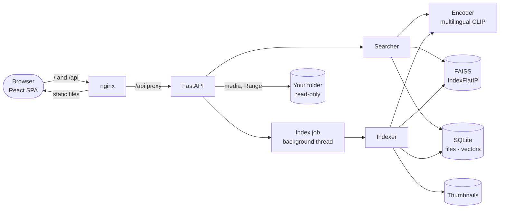
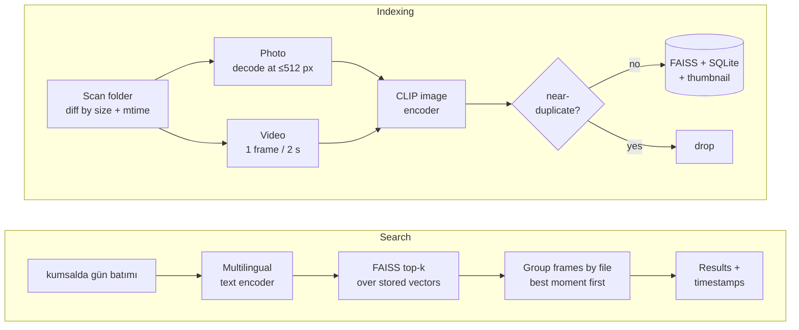

# Galeria

**Semantic search for your photos and videos, in any language.** Index a folder, then type what
you remember — *"kumsalda gün batımı"*, *"a cat curled up in a box"* — and get matching photos
and the exact second of matching videos in milliseconds. Everything runs locally.

- **Multilingual:** one shared embedding space for images and 50+ languages (multilingual CLIP),
  so Turkish and English queries search the same index.
- **Videos by moment:** frames are sampled every 2 s and near-duplicates dropped; a video result
  opens at the best-matching second, with every other matching moment one click away.
- **Fast:** ~7 ms per query (text encoding + exact FAISS search + metadata) on a laptop CPU.
- **Measured:** a reproducible eval on 151 openly licensed Wikimedia Commons files — P@3 0.93,
  with an honest look at where Turkish queries fall behind English ones.
- **Incremental:** re-indexing only touches new, changed and deleted files.

Stack: Python 3.12 · FastAPI · sentence-transformers (CLIP) · FAISS · SQLite · PyAV ·
React 19 + TypeScript + Vite · Docker.

## Architecture





The multilingual text model was distilled to reproduce the original CLIP text embeddings, which
is why it can be paired with the CLIP image tower: both land in the same 512-d space. Design
notes, trade-offs and the bugs worth knowing about are in
[docs/architecture.md](docs/architecture.md).

## Quick start

### Docker

```bash
docker compose up --build
```

Open <http://localhost:8080>, click **Index folder** and start indexing `/media`. By default
`/media` is `./samples` (see [Eval](#eval) to download it); to search your own library:

```bash
MEDIA_DIR=~/Pictures docker compose up --build
```

The folder is mounted read-only, and the API refuses to index anything outside it. The first
start downloads the model weights (~600 MB) into a volume, so later starts take seconds.

### Local development

Needs [uv](https://docs.astral.sh/uv/) and Node 20.19+.

```bash
make setup     # uv sync + npm ci
make api       # API on :8000
make web       # UI on :5173, proxies /api to :8000
```

Or from the command line:

```bash
cd backend
uv run galeria index ~/Pictures
uv run galeria search "kedi kutuda" -k 5
uv run galeria search "fireworks" --type video --min-score 0.28
```

`make help` lists every task (`test`, `lint`, `samples`, `eval`, `up`, `down`, …).

## Eval

A small, fully reproducible benchmark lives in [eval/](eval/).

**Data.** 20 topics × 7 photos, 6 short videos and one synthetic video, all from Wikimedia
Commons (CC BY / CC BY-SA / CC0 / public domain; authors and licenses in
[scripts/samples_manifest.json](scripts/samples_manifest.json), pinned by sha256). Relevance
labels are not hand-guessed: each file inherits its curated Commons category, e.g. *Cats in
boxes*. Every photo was then looked at, and 4 that don't show their topic (a "Pizza" protest
sign, Bavarian pretzels filed under *Simit*, …) are kept as distractors with no label — see
[eval/label_audit.yaml](eval/label_audit.yaml). Topics include deliberate near-misses (dogs vs.
foxes in snow, Bosphorus Bridge vs. Galata Tower) and Turkey-specific ones (Cappadocia balloons,
Istanbul trams, simit).

**Queries.** 40 retrieval queries (each topic once in Turkish, once in English, paraphrased
rather than repeating the category name), plus video, moment and no-match queries —
[eval/queries.yaml](eval/queries.yaml).

```bash
make samples   # ~76 MB, verified against the manifest checksums
make eval      # writes eval/results/latest.md
```

### Results

| Queries | P@3 | hit@3 | MRR@10 |
|---|---|---|---|
| All (40) | **0.933** | 0.950 | 0.953 |
| Turkish (20) | 0.867 | 0.900 | 0.905 |
| English (20) | 1.000 | 1.000 | 1.000 |

- **Video moments:** the search lands inside the right 6-second segment of the synthetic video
  for 8 of 10 queries. Picking the right one of 6 real videos works for 4 of 6 (scores between
  videos are within 0.02 of each other, and 6 queries is too few to read much into).
- Full per-query breakdown: [eval/results/latest.md](eval/results/latest.md).

**Where Turkish falls behind.** All misses are Turkish. The obvious guess — the model doesn't
know the words — is wrong: it embeds *lale* next to *tulip* (cosine 0.84) and *susamlı simit*
next to *sesame bagel* (0.94). The gap is at sentence level. Comparing each Turkish query with
its English twin, the worst-aligned pair, *"sıra sıra renkli lale tarlası"* (0.53, the
reduplicated *sıra sıra* reads like nothing the model was distilled on), is also the only total
miss besides *"susamlı simit"*, a culture-specific dish the image side places poorly unless it is
described ("a Turkish sesame bread ring" finds it). The two partial misses are reasonable
confusions, such as a Bosphorus sunset for *"denizin üzerinde gün batımı"*. Queries were not
reworded to pass. A stronger multilingual model (e.g. SigLIP 2) is the obvious next experiment;
the encoder is one class behind a protocol, so the same eval can compare them.

### Choices the eval drove

**Query encoding runs on the CPU.** On Apple Silicon both work, but MPS compiles kernels for each
new input length:

| Text encoder device | Median | p95 |
|---|---|---|
| MPS (Apple GPU) | 5.8 ms | 128 ms |
| **CPU (default)** | 6.8 ms | **7.3 ms** |
| CPU in Docker (OrbStack, linux/arm64) | ~23 ms | 35 ms (worst of 20) |

Retrieval quality is identical. Images are still encoded on the GPU, where batching pays off
(22 photos index in 0.9 s; 220 in 2.7 s). The Docker number is slower because the Linux build of
PyTorch cannot use Apple's Accelerate framework inside the VM; it was not measured on x86
servers.

**An optional score cutoff.** Top-1 scores of answered queries range 0.273–0.372; queries with
no match in the set top out at 0.281. A cutoff of 0.283 keeps 89% of correct top hits and hides
all no-match queries — but that rests on six negative queries, so it is opt-in
(`GALERIA_MIN_SCORE`, `?min_score=`, `--min-score`) rather than the default.

## API

Interactive docs at `/docs` when the API is running.

| Endpoint | |
|---|---|
| `GET /api/search?q=&k=24&type=all\|photo\|video&min_score=` | Results with score, thumbnail, media URL and, for videos, best timestamp plus all matching moments. Timings are split into encode and search. |
| `POST /api/index` `{"folder": "/media"}` | Starts indexing in the background (409 if one is running, 403 outside `GALERIA_ALLOWED_ROOTS`). |
| `GET /api/index/status` | Progress and the final report. |
| `GET /api/media/{id}` | The original file, with HTTP Range support so `<video>` can seek. Only files inside indexed folders are served. |
| `GET /api/thumbs/{name}` | Thumbnails, cached as immutable. |
| `GET /api/stats`, `GET /api/health` | Counts, roots, encoder; liveness. |

## Configuration

All settings are environment variables (or a `.env` file in `backend/`).

| Variable | Default | |
|---|---|---|
| `GALERIA_DATA_DIR` | `data` | Index, SQLite metadata and thumbnails |
| `GALERIA_DEVICE` | `auto` | Image encoder device: `auto`, `cpu`, `mps`, `cuda` |
| `GALERIA_TEXT_DEVICE` | `cpu` | Query encoder device (see the latency table) |
| `GALERIA_MIN_SCORE` | unset | Hide results below this cosine similarity |
| `GALERIA_FRAME_INTERVAL` | `2.0` | Seconds between sampled video frames |
| `GALERIA_FRAME_DEDUP_THRESHOLD` | `0.95` | Drop frames this similar to the last kept one |
| `GALERIA_MAX_FRAMES_PER_VIDEO` | `900` | Longer videos widen the interval |
| `GALERIA_ALLOWED_ROOTS` | `[]` (any) | JSON list of folders the API may index |
| `GALERIA_IMAGE_MODEL`, `GALERIA_TEXT_MODEL` | CLIP ViT-B/32 pair | An index refuses to open with a different model |

## Project layout

```
backend/galeria/
  core/        scanner · video · thumbnails · encoder · vector_store · metadata · indexer · search
  api/         FastAPI app, routes, background index job
  cli.py       galeria index | search | stats | serve
backend/tests/ 78 pytest tests; a fake color-based encoder keeps them model-free (<1 s)
frontend/src/  React app: search bar, grid, viewer, indexing panel; 13 Vitest tests
eval/          dataset definition, queries, label audit, run_eval.py, results
scripts/       Commons manifest builder and checksummed downloader
docs/          architecture and design notes
```

## Testing

```bash
make test   # pytest + vitest, ~5 s, no network or model download
make lint   # ruff check + format check + tsc
```

Backend tests generate their own images and H.264 clips (solid-color segments), and use a fake
encoder that embeds images by mean color and color words by axis — so *"kırmızı"* has to find
the red photo, and *"green"* the 4-second mark of a red-green-blue clip. CI runs the same checks
and builds both Docker images on every push.

## Limitations

- Exact search is fine to ~100k vectors; beyond that, swap `IndexFlatIP` for IVF or HNSW.
- HEIC photos (iPhone default) aren't decoded yet; `pillow-heif` would add them.
- Portrait phone videos are rotated per the container's display matrix as documented by PyAV,
  but this hasn't been checked against a real phone recording.
- One indexing job at a time; no authentication — the API is meant for localhost or behind a
  trusted proxy.

## Credits

Sample media: Wikimedia Commons contributors; per-file attribution is generated into
`samples/ATTRIBUTION.md` by `make samples`. Models: [OpenAI CLIP](https://github.com/openai/CLIP)
and [sentence-transformers](https://www.sbert.net/) multilingual distillation.
